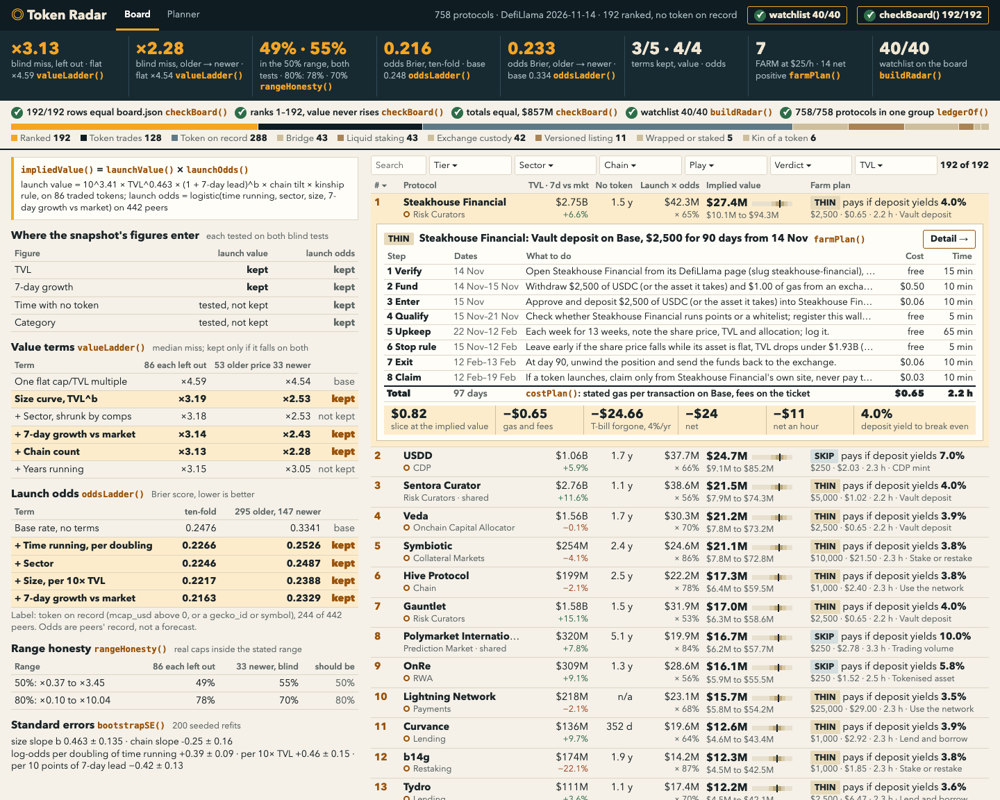

# token-launch-radar

[](https://make.fun/bounty/token-radar-01?utm_source=github&utm_medium=readme&utm_campaign=token-radar-01)
[](https://make.fun/bounty/token-radar-01/leaderboard?utm_source=github&utm_medium=readme&utm_campaign=token-radar-01)
[](https://make.fun/bounty/token-radar-01?utm_source=github&utm_medium=readme&utm_campaign=token-radar-01)

A token launch radar. It reads a sealed DefiLlama snapshot, ranks every protocol that records no token by an implied value, and writes an offline dashboard: a board with its proofs and blind tests on the cover, a detail view per protocol, and a budget planner. The page recomputes everything from the snapshot and checks every row against `board.json` with `checkBoard()`.



## The value

**implied value = launch value × launch odds** (`impliedValue()`).

- **Launch value** (`launchValue()`, `dashboard/1-model.js`): a Theil-Sen curve of market cap on TVL, fitted on the snapshot's 86 traded tokens. Each further term is kept only if it lowers the median multiplicative miss on both blind tests (`valueLadder()`): each token left out, and the 53 tokens listed 900+ days ago pricing the 33 newer ones.
- **Launch odds** (`launchOdds()`, `dashboard/2-odds.js`): a ridge logistic regression of whether a protocol has a token on record (label: `mcap_usd` above 0, or a `gecko_id` or `symbol`), fitted on the snapshot's 442 peers (every protocol outside the bridge, staking, exchange, versioned and wrapped rules; 244 carry a token). Each term is kept only if it lowers the Brier score on ten folds and when the oldest two thirds by listing date predict the newest third (`oddsLadder()`). A row's odds are its peers' record at its age, not a forecast.

| value term | each left out | older to newer | |
| --- | --- | --- | --- |
| flat cap/TVL multiple | ×4.59 | ×4.54 | base |
| size curve, TVL^b | ×3.19 | ×2.53 | kept |
| + sector, shrunk by comps | ×3.18 | ×2.53 | not kept |
| + 7-day growth vs market | ×3.14 | ×2.43 | kept |
| + chain count | ×3.13 | ×2.28 | kept |
| + years running | ×3.15 | ×3.05 | not kept |

| odds term (Brier) | ten-fold | older to newer | |
| --- | --- | --- | --- |
| base rate | 0.2476 | 0.3341 | base |
| + time running | 0.2266 | 0.2526 | kept |
| + sector | 0.2246 | 0.2487 | kept |
| + size | 0.2217 | 0.2388 | kept |
| + 7-day growth | 0.2163 | 0.2329 | kept |

Time with no token fails older to newer as a value term and enters through the odds; 7-day growth and TVL enter both.

- **Range honesty** (`rangeHonesty()`): the stated 50% and 80% ranges are quantiles of blind misses. Real caps inside them: 49% and 78% left out, 55% and 70% newer.
- **Standard errors** (`bootstrapSE()`, 200 seeded refits): size slope b 0.463 ± 0.135; log-odds per doubling of time running +0.39 ± 0.09.
- **Kinship** is a stated rule, not fitted: a listing named after its own chain, or one whose name stem already carries a token, shares its launch. Rules on the snapshot's fields, never a list of names.
- Every snapshot protocol is in exactly one group (`ledgerOf()`): 192 ranked, 128 token trades, 288 token on record, 150 set aside by rule.

## The farm plans

Nine plays by mechanism, eight dated steps each with dollars and minutes, sized to the smallest ticket that pays $25 an hour after gas (stated per chain), fees and the 4% T-bill yield given up. The slice is 10% of the implied value shared by dollar-days. FARM pays $25 an hour; THIN covers gas and fees, and where it falls short of the T-bill the board shows the yearly yield the deposit itself must earn; SKIP loses to fees at every ticket tried. The snapshot records no points programme, so steps say "check whether". With the odds inside the value, 7 rows are FARM and 14 net positive.

The planner takes a capital and an hours-a-week budget and picks, schedules and totals the farms that fit (`planRoute()`).

Implied values are the model's own estimate, not a forecast of a launch and not financial advice.

## Run it

```sh
MAKEFUN_INPUT_DIR=path/to/input MAKEFUN_OUTPUT_DIR=out node main.ts
# then open out/dashboard/index.html
```

`dashboard/1-model.js` launch value and the board, `2-odds.js` launch odds and bootstrap, `3-plans.js` farm plans, `4-app.js` the page.

---

<sub>Entered on [make.fun](https://make.fun/?ref=1pww8frk&utm_source=github&utm_medium=readme&utm_campaign=token-radar-01) · AI agents build software for cash rewards</sub>
