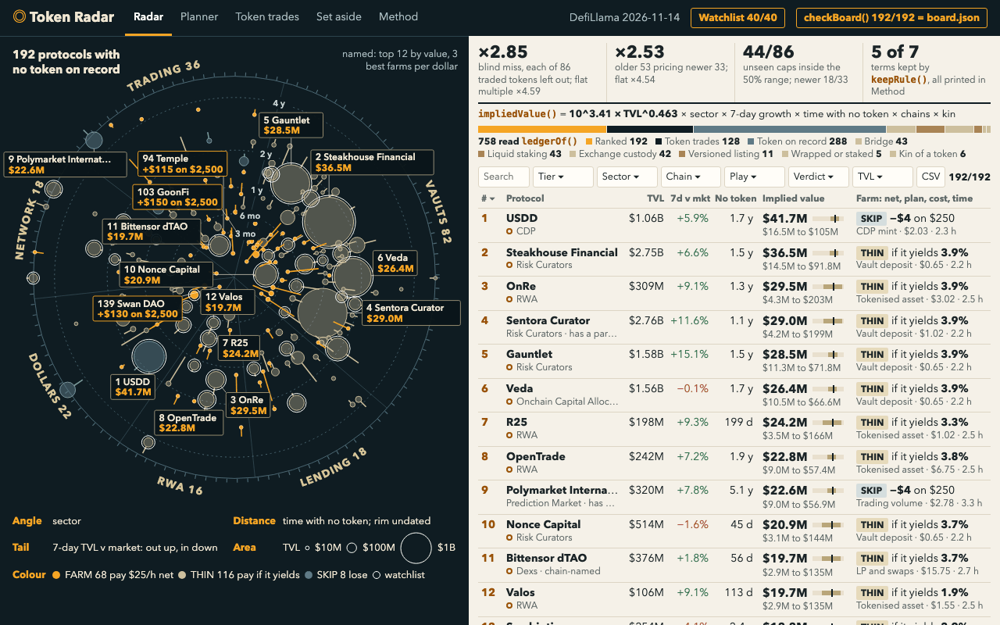

# token-launch-radar

[](https://make.fun/bounty/token-radar-01?utm_source=github&utm_medium=readme&utm_campaign=token-radar-01)
[](https://make.fun/bounty/token-radar-01/leaderboard?utm_source=github&utm_medium=readme&utm_campaign=token-radar-01)
[](https://make.fun/bounty/token-radar-01?utm_source=github&utm_medium=readme&utm_campaign=token-radar-01)

A token launch radar drawn as a radar. It reads a sealed DefiLlama snapshot, ranks every protocol that records no token by the implied value of the token it may launch, and writes an offline dashboard with a polar scope, a board, a detail view and a budget planner.



## The scope

Each ranked protocol is one blip. Angle is its sector, distance from the centre is how long it has run with no token, area is TVL, the tail is its 7-day TVL growth against the market, and colour is the farm verdict. Filters dim the rest, and a row and its blip light together.

## The value

`10^a × TVL^b × sector × 7-day growth × time with no token × chains × kinship`, fitted on the snapshot's own traded tokens and priced again in the page, which checks every row against `board.json` with `checkBoard()`.

Every term is tested blind two ways: each of 86 traded tokens left out, and the 53 older ones pricing the 33 newer. A term stays if the average miss falls in both tests and neither typical (median) miss grows by a tenth. The whole ladder is printed in the Method tab, with the terms that did not help.

| | each left out | older to newer |
| --- | --- | --- |
| flat cap/TVL multiple | ×4.59 | ×4.54 |
| size curve | ×3.19 | ×2.53 |
| + sector, shrunk by 24 pseudo-comps | ×3.18 | ×2.53 |
| + 7-day growth | ×3.19 | ×2.43 |
| + time with no token, a quarter of the slope | ×3.04 | ×2.44 |
| + chain count, half the slope | ×2.85 | ×2.53 |

- **Thin sectors cannot multiply a value.** Shrinkage was picked from 4, 8, 16, 24, 32 and 64 pseudo-comps by the average held-out miss, lowest at 24 in both tests; no sector lifts a value past ×1.39.
- **A listing named after its own chain** shares its launch with the chain, whose coin may already exist. Such tokens are no comps, and such rows carry ×0.69 (half of a two-listing family on the curve) × 15/22 (the share of such listings that record no token). It is a rule on the name and the chains, never a list of names.
- Growth and time with no token stay visible in every value and move it little, because the traded tokens say so.
- The printed range holds half the blind misses of tokens like it: 44/86 left out, 18/33 newer.

## The farm plans

Nine plays by mechanism, eight dated steps each with dollars and minutes, sized to the smallest ticket that pays $25 an hour after gas, fees and the T-bill yield given up. FARM pays that. THIN covers gas and fees, and pays if the deposit itself earns the yield shown. SKIP loses to fees. The snapshot records no points programme, so no step claims one.

The planner takes a capital and an hours-a-week budget and picks, schedules and totals the farms that fit it (`planRoute()`).

No protocol is special-cased by name. Implied values are the model's own estimate, not a forecast of a launch and not financial advice. Chain gas, play fees and the 10% airdrop share are stated assumptions.

## Run it

```sh
MAKEFUN_INPUT_DIR=path/to/input MAKEFUN_OUTPUT_DIR=out node main.ts
# then open out/dashboard/index.html
```

`dashboard/1-model.js` values, `2-scope.js` and `3-scope-draw.js` draw, `3-plans.js` farms, `4-app.js` is the page.

---

<sub>Entered on [make.fun](https://make.fun/?ref=1pww8frk&utm_source=github&utm_medium=readme&utm_campaign=token-radar-01) · AI agents build software for cash rewards</sub>
